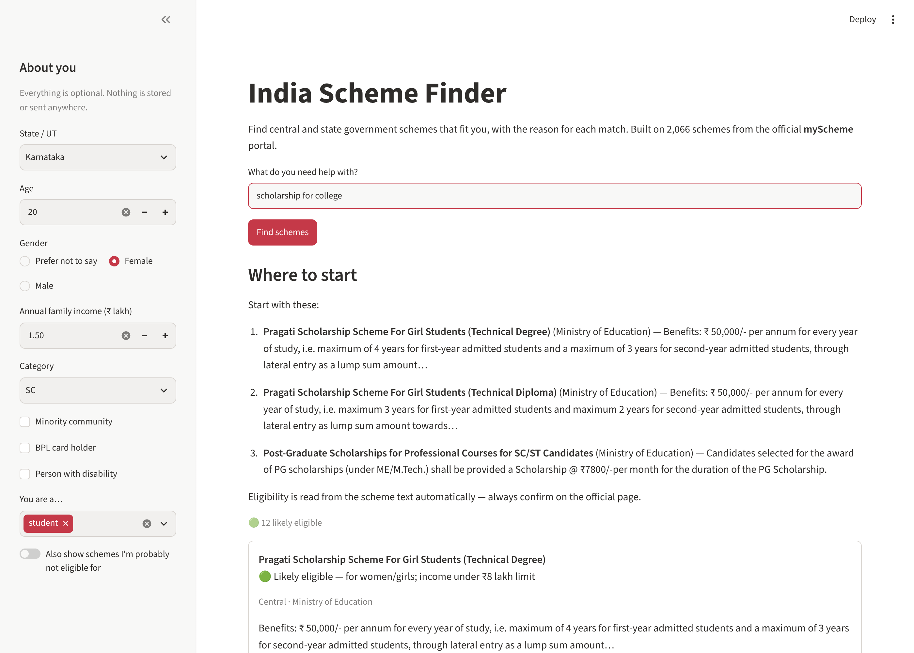
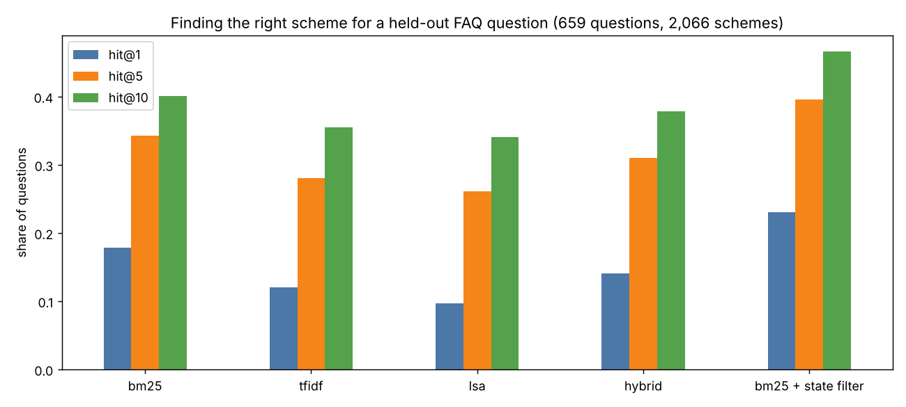

# India Scheme Finder

**Which government schemes am I eligible for?** Tell it your state, age, income, category and what you need. It searches **2,066 central and state schemes** from the official [myScheme](https://www.myscheme.gov.in) portal and shows the ones that fit, each with the reason. You can then ask questions about any scheme ("what documents do I need?") and get answers quoted from that scheme's own text.



## Why

India runs thousands of welfare schemes, but the rules are buried in long, inconsistent text written by hundreds of departments. Many eligible people never apply because they can't tell which schemes are meant for them. This project turns that text into something a person can query in a minute.

## What it does

| Part | How | Result (measured, see notebook) |
|---|---|---|
| **Eligibility parser** | Rules that read age limits, family-income caps, women-only and SC/ST/OBC/minority/BPL/disability requirements out of free text | Income caps: **5/5 correct** on a blind test set (12/12 on dev). Age limits mostly right; two-stage rules are the weak spot |
| **Search** | BM25 over name, tags, description, eligibility and benefits, limited to central schemes + the user's state | Right scheme in the top 5 for **40%** of held-out FAQ questions (top 1: **23%**), out of 2,066 schemes |
| **Eligibility check** | Compares the profile with the parsed rules → *likely eligible* / *check details* / *probably not eligible*, always with a reason | A scheme is only "likely" if at least one rule actually matched |
| **Scheme Q&A (RAG)** | Splits one scheme into labelled passages (FAQ, who can / cannot apply, benefits, how to apply, documents), routes the question to the right section, and quotes it | Answers always say which section they came from |
| **Optional LLM** | Sends only the retrieved text to any OpenAI-compatible API (Groq, OpenRouter, local Ollama…) with an instruction to use nothing else | Off by default; the app works fully offline |

## Results



**Search**: 659 held-out questions, 2,066 schemes

| Method | hit@1 | hit@5 | hit@10 | MRR |
|---|---|---|---|---|
| BM25 | 0.179 | 0.343 | 0.401 | 0.255 |
| TF-IDF | 0.120 | 0.281 | 0.355 | 0.200 |
| LSA (latent semantic) | 0.097 | 0.261 | 0.341 | 0.173 |
| BM25 + LSA hybrid | 0.141 | 0.310 | 0.378 | 0.222 |
| **BM25 + user's state** | **0.231** | **0.396** | **0.466** | **0.313** |

* The test questions are real FAQ questions. FAQs are kept out of the index, and questions containing a distinctive word of the scheme's name are removed, so a query can't just match the title. BM25 settings were tuned on the other half of the questions.
* **Plain BM25 beat the "semantic" hybrid** at every fusion weight I tried, so the app uses BM25. Knowing the user's state is the biggest single gain (MRR +23%).
* The absolute numbers are modest because many FAQ questions only make sense next to their own scheme ("Is this scheme also covering travel expense?"). Fewer than 4% of the misses are near-duplicate schemes.

**Eligibility parser**: hand-labelled samples (dev = 40 schemes used while writing rules; test = 30 different schemes labelled blind)

| Field | Dev precision | Test precision | Test recall |
|---|---|---|---|
| Income cap | 12/12 | 5/5 | 5/5 |
| Minimum age | 9/10 | 5/5 | 5/6 |
| Maximum age | 4/7 | 4/7 | 4/7 |
| Women/girls only | 6/6 | 2/2 | 2/4 |

The first blind run found two real bugs. "Should **not** be above 55 years" was read as a *minimum* age of 55, and "0 to 6 **months**" was read as an age. Both are fixed, and the test numbers above are from after the fix, so they're no longer fully blind (before the fix: max-age precision 3/6). Because the parser can be wrong, the app never hides *why* a scheme is marked not eligible, and category rules only ever produce "check details", never "not eligible".

## Run it

```bash
pip install -r requirements.txt
streamlit run app.py
```

Optional LLM answers: copy `.env.example`, fill it in, and export the variables before starting. Any OpenAI-compatible endpoint works; for example, a local [Ollama](https://ollama.com) needs no key:

```bash
export LLM_BASE_URL=http://localhost:11434/v1
export LLM_MODEL=llama3.1
```

Run the tests and the evaluation:

```bash
pytest -q
jupyter notebook notebooks/scheme_finder_evaluation.ipynb
```

## Project layout

```
app.py                         Streamlit app
scheme_finder/parse.py         free-text eligibility → structured rules
scheme_finder/retrieve.py      BM25 / TF-IDF / LSA / hybrid search
scheme_finder/eligibility.py   profile vs rules, with reasons
scheme_finder/assistant.py     finder, per-scheme Q&A (RAG), optional LLM
eval/                          hand labels, query builder, scoring scripts
notebooks/                     executed evaluation notebook
tests/                         unit tests (16)
data/gov_myscheme_data.csv     2,066 schemes
```

## Limitations

* Eligibility is read with rules, not understood. Schemes with two-stage rules (e.g. "register at 18–60, pension from 60") can be misread.
* The data is a snapshot. Amounts, deadlines and rules change, so every result links to the official page. **This is not an official government service.**
* LLM mode was tested against a local mock server, not a live model.

## Data and credits

* Scheme data: myScheme portal (Government of India), via [Aryan-Pardeshi/gov-myscheme-dataset](https://github.com/Aryan-Pardeshi/gov-myscheme-dataset) (Apache-2.0), which builds on [shrijayan/gov_myscheme](https://huggingface.co/datasets/shrijayan/gov_myscheme).
* Built with AI assistance (Claude) for code and evaluation design. Hand labels, testing and decisions are documented in `eval/` and the notebook.
